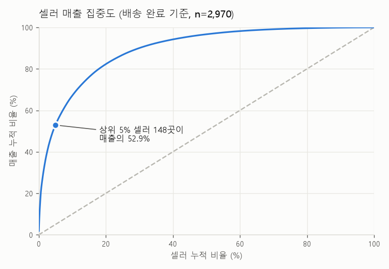
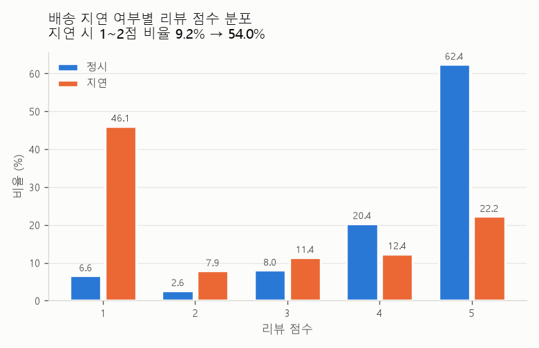
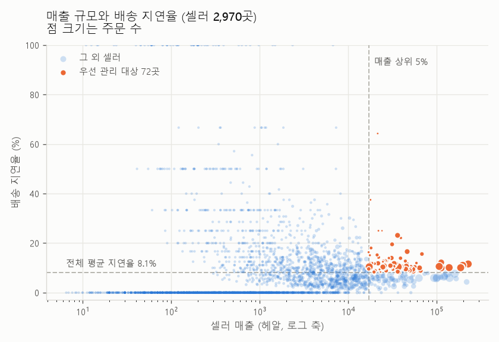

# 마켓플레이스 셀러 운영 분석 — 어떤 셀러를 먼저 관리해야 하는가

브라질 이커머스 마켓플레이스 Olist의 주문 데이터를 SQL로 분석해,
매출 기여와 배송 품질을 기준으로 우선 관리 대상 셀러를 선별했습니다.

**결론: 셀러 72곳(전체의 2.4%)이 매출의 25.9%를 담당하면서 배송 지연 주문의 31.7%를 발생시킵니다.**

---

## 1. 데이터와 도구

| 항목 | 내용 |
|---|---|
| 데이터 | Brazilian E-Commerce Public Dataset by Olist (Kaggle) |
| 기간 | 2016.09 ~ 2018.10 |
| 규모 | 주문 99,441건 · 셀러 3,095곳 · 테이블 7개 |
| 도구 | DuckDB(SQL), Python(pandas, matplotlib) |
| 작업 형태 | 개인 100% |

### 데이터의 한계
- 리뷰가 등록된 구매만 무작위 추출한 표본입니다. 같은 고객의 주문이 일부만 포함됐을 수 있어
  **재구매율은 실제보다 낮게 측정될 가능성이 있습니다.**
- Olist 플랫폼에서 직접 발생한 거래만 포함합니다.
- 2016~2018년 브라질 시장 데이터이므로, 수치를 현재 국내 시장에 그대로 적용할 수 없습니다.

---

## 2. 분석 기준

분석 전 각 테이블의 기준 단위를 확인하고, 아래 기준을 먼저 확정했습니다.

| 항목 | 기준 | 이유 |
|---|---|---|
| 대상 주문 | `order_status = 'delivered'` (96,478건) | 취소·품절 주문은 상품 정보가 연결되지 않음 |
| 매출 | `items.price` 합계 (13,221,500헤알) | 결제액에는 할부 이자가 포함되어 셀러 실매출과 다름 |
| 고객 수 | `customer_unique_id` 기준 (93,358명) | `customer_id`는 주문마다 새로 부여됨 |
| 배송 지연 | 실제 수령일 > 약속한 배송 예정일 | |

기준에 따라 셀러 수가 3,095곳(전체 주문)과 2,970곳(배송 완료)으로 달라집니다.
본 분석은 **배송 완료 기준 2,970곳**을 사용합니다.

---

## 3. 데이터 검증

분석에 앞서 조인과 집계가 왜곡되는 지점을 찾아 처리했습니다. 상세 내역은 [검증일지.md](검증일지.md) 참고.

| # | 발견 | 영향 | 조치 |
|---|---|---|---|
| 1 | 상품 정보가 없는 주문 775건 | 주문 수와 매출의 분모 불일치 | 품절(99%)·취소로 확인, delivered 기준으로 한정 |
| 2 | 주문보다 많은 결제 행 4,446행 | 조인 시 금액 중복 합산 | 주문 단위로 합계를 낸 뒤 결합 |
| 3 | 주문 금액과 결제 금액 불일치 380건 | 매출 기준 선택 | 불일치 주문의 92%가 신용카드, 평균 할부 5.8개월(전체 3.5개월의 1.7배) → 할부 이자로 추정, 매출은 상품가 기준 채택 |
| 4 | 리뷰 테이블 중복 (99,224행 / 고유 주문 98,673 / 고유 리뷰 98,410) | 평균 점수 왜곡 | 주문별 평균 점수로 1주문=1행 정리 후 조인 |
| 5 | 결제 기록이 없는 주문 1건 | — | 2016년 9월(데이터 최초 시기) 건으로 원인 확정 불가, 영향 없음 확인 |
| 6 | 지연율 100%인 셀러 57곳 중 52곳이 주문 1건 | 비율 지표 왜곡 | 우선 관리 대상을 주문 수가 충분한 매출 상위 구간으로 한정 |

주문 1건이 여러 셀러 상품으로 구성된 경우, 셀러별 집계에서는 지연이 중복 계산됩니다
(셀러 기준 7,844건 vs 주문 기준 7,826건). 지표에 따라 분모를 구분해 사용했습니다.

---

## 4. 결과 1 — 매출은 소수 셀러에 집중되어 있다



| 구간 | 셀러 수 | 매출 비중 | 누적 비중 |
|---|---|---|---|
| 상위 1% | 29 | 25.5% | 25.5% |
| 상위 1~5% | 119 | 27.4% | **52.9%** |
| 상위 5~10% | 149 | 14.2% | 67.1% |
| 상위 10~20% | 297 | 15.2% | 82.3% |
| 하위 80% | 2,376 | 17.7% | 100% |

- 셀러 148곳(상위 5%)이 매출의 절반을 넘깁니다.
- 셀러 1곳당 평균 매출은 상위 1% 약 116,000헤알, 하위 80% 약 986헤알로 **118배** 차이입니다.
- 관리 대상을 2,970곳 전체로 잡을 필요가 없다는 뜻입니다.

---

## 5. 결과 2 — 배송 지연은 평판에 직결된다



배송 완료 96,478건 중 **7,826건(8.1%)**이 약속일보다 늦게 도착했습니다.

| 구분 | 건수 | 평균 리뷰 점수 | 1~2점 비율 |
|---|---|---|---|
| 정시 | 88,171 | 4.29 | 9.2% |
| 지연 | 7,661 | 2.57 | **54.0%** |

※ 위 건수는 리뷰가 등록된 주문만 집계한 것으로, 전체 지연 7,826건과 차이가 있습니다.
- 배송이 늦으면 불만 리뷰 비율이 **5.9배**로 뜁니다.
- 지연된 주문의 절반 이상이 1~2점을 받습니다.
- 전체 주문의 8.1%에 불과한 지연이 낮은 평점의 상당 부분을 만들고 있습니다.

---

## 6. 결과 3 — 우선 관리 대상 셀러 72곳



매출 상위 5%와 전체 평균 지연율(8.1%)을 기준으로 셀러를 네 구간으로 나눴습니다.

| 구간 | 셀러 수 | 매출 비중 | 지연 주문 | 지연 비중 |
|---|---|---|---|---|
| 상위 5% · 지연율 평균 이하 | 76 | 27.0% | 1,317 | 16.8% |
| **상위 5% · 지연율 초과** | **72** | **25.9%** | **2,488** | **31.7%** |
| 그 외 · 평균 이하 | 1,987 | 28.7% | 1,210 | 15.4% |
| 그 외 · 지연율 초과 | 835 | 18.4% | 2,829 | 36.1% |

**이 72곳을 먼저 보는 이유**

1. 지연 주문이 가장 많은 구간은 '그 외 · 지연율 초과'(2,829건)이지만 셀러가 835곳이라
   개별 관리가 어렵습니다. 72곳은 **11분의 1 규모로 비슷한 효과**를 낼 수 있습니다.
2. 이들이 매출의 4분의 1을 담당하므로, 품질 문제를 방치하면 매출에 직접 영향이 갑니다.
3. 앞 결과(지연 주문의 54%가 1~2점)를 적용하면 이 72곳에서만 **약 1,340건의 불만 리뷰**가 발생합니다.

**규모가 크다고 배송이 나쁜 것은 아닙니다**

상위 5%의 나머지 76곳은 지연율이 평균 이하입니다.
주문 규모별로도 21건 이상 셀러의 평균 지연율이 7.7%로, 1건 셀러(9.7%)보다 낮습니다.
지연은 규모의 문제가 아니라 **개별 셀러의 운영 역량 문제**로 보입니다.

---

## 7. 결과 4 — 재구매는 거의 일어나지 않는다

| 구분 | 고객 수 | 비율 |
|---|---|---|
| 1회 구매 | 90,557 | 97.0% |
| 2회 이상 | 2,801 | **3.0%** |

첫 주문 경험이 재구매에 영향을 주는지 확인했습니다.

| 첫 주문 | 고객 수 | 재구매율 |
|---|---|---|
| 정시 | 85,756 | 3.05% |
| 지연 | 7,602 | **2.49%** |

- 첫 주문이 지연된 고객의 재구매율이 0.56%p 낮습니다(상대적으로 18% 낮음).
- 다만 **차이는 크지 않습니다.** 재구매율 자체가 3% 수준이라
  지연 여부와 관계없이 대부분 한 번만 구매합니다.
- 따라서 배송 품질 개선의 근거는 재구매보다 **평판(리뷰 점수)** 쪽에서 찾는 것이 타당합니다.
- 표본 특성상 실제 재구매율은 이보다 높을 수 있어, 수치를 시장 전체로 일반화하지 않았습니다.

---

## 8. 한계와 다음 단계

**한계**
- 배송 지연의 책임이 셀러에 있는지 물류사에 있는지 데이터로 구분할 수 없습니다.
- 할부 이자 가설은 이자율 항목이 없어 금액으로 직접 검증하지 못했습니다.
- 재구매율 차이의 통계적 유의성은 별도 검정을 수행하지 않았습니다.

**다음 단계로 해보고 싶은 것**
- 셀러 지역과 고객 지역의 거리를 반영해 지연 요인을 분리
- 상품 카테고리별 지연율 비교
- 우선 관리 대상 셀러의 월별 지연율 추이 모니터링

---

## 9. 파일 구성

```
olist-marketplace/
├─ analysis.ipynb          분석 노트북 (전체 실행 기록)
├─ 검증일지.md              데이터 검증 상세 기록
├─ sql/
│  ├─ 01_데이터검증.sql
│  ├─ 02_매출집중도.sql
│  ├─ 03_배송품질.sql
│  └─ 04_재구매.sql
└─ charts/                 결과 이미지 3종
```

데이터는 용량 문제로 포함하지 않았습니다.
[Kaggle 원본](https://www.kaggle.com/datasets/olistbr/brazilian-ecommerce)을 받아
`data/` 폴더에 넣으면 노트북이 그대로 실행됩니다.